

 

<a href="https://rithwikbandi.tech"><picture><source media="(prefers-color-scheme: light)" srcset="assets/light/btn-portfolio.svg" /></picture></a>
<a href="https://www.linkedin.com/in/rithwik-bandi/"><picture><source media="(prefers-color-scheme: light)" srcset="assets/light/btn-linkedin.svg" /></picture></a>
<a href="https://www.burntstack.com"><picture><source media="(prefers-color-scheme: light)" srcset="assets/light/btn-burntstack.svg" /></picture></a>
<a href="https://pixelsandcodestudios.com"><picture><source media="(prefers-color-scheme: light)" srcset="assets/light/btn-pcs.svg" /></picture></a>

 

<picture><source media="(prefers-color-scheme: light)" srcset="assets/light/h-about.svg" /></picture>


 

I'm a **Computer Science student at SR University (Warangal)** who builds real products instead of waiting for permission to. I design and ship full-stack web apps, train and explain machine-learning models, and run two ventures on the side: a custom web studio and a personal-branding agency. I document the whole journey in public, one short video at a time.

 

<picture><source media="(prefers-color-scheme: light)" srcset="assets/light/h-ventures.svg" /></picture>

<table>
<tr>
<td><a href="https://www.burntstack.com"><picture><source media="(prefers-color-scheme: light)" srcset="assets/light/v-burntstack.svg" /></picture></a></td>
<td><a href="https://pixelsandcodestudios.com"><picture><source media="(prefers-color-scheme: light)" srcset="assets/light/v-pcs.svg" /></picture></a></td>
<td><picture><source media="(prefers-color-scheme: light)" srcset="assets/light/v-series.svg" /></picture></td>
</tr>
</table>

 

<picture><source media="(prefers-color-scheme: light)" srcset="assets/light/h-work.svg" /></picture>

<table>
<tr>
<td><a href="https://job-space-deployment.vercel.app"><picture><source media="(prefers-color-scheme: light)" srcset="assets/light/p-jobspace.svg" /></picture></a></td>
<td><a href="https://folio-converter.vercel.app"><picture><source media="(prefers-color-scheme: light)" srcset="assets/light/p-folio.svg" /></picture></a></td>
<td><a href="https://github.com/RithwikBandi/Heart-Risk-AI"><picture><source media="(prefers-color-scheme: light)" srcset="assets/light/p-cardioml.svg" /></picture></a></td>
</tr>
<tr>
<td><a href="https://sru-time-table.vercel.app"><picture><source media="(prefers-color-scheme: light)" srcset="assets/light/p-timetable.svg" /></picture></a></td>
<td><a href="https://marvel-show-case.vercel.app"><picture><source media="(prefers-color-scheme: light)" srcset="assets/light/p-marvel.svg" /></picture></a></td>
<td><a href="https://rithwikbandi.tech"><picture><source media="(prefers-color-scheme: light)" srcset="assets/light/p-portfolio.svg" /></picture></a></td>
</tr>
</table>

 

<picture><source media="(prefers-color-scheme: light)" srcset="assets/light/h-stack.svg" /></picture>

<picture><source media="(prefers-color-scheme: light)" srcset="assets/light/stack3d.svg" />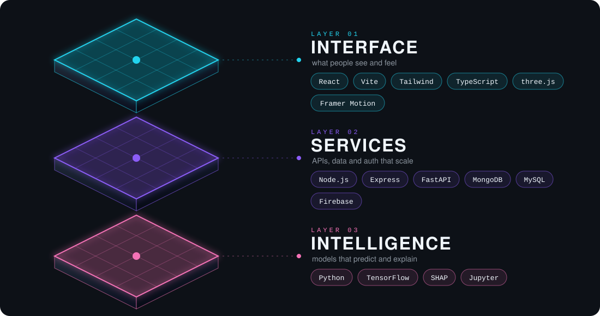</picture>

  

<picture>
  <source media="(prefers-color-scheme: light)" srcset="https://skillicons.dev/icons?i=react%2Cvite%2Cts%2Cjs%2Ctailwind%2Chtml%2Ccss%2Cnodejs%2Cexpress%2Cfastapi%2Cmongodb%2Cmysql%2Cfirebase%2Cpython%2Ctensorflow%2Cthreejs%2Cgit%2Cgithub%2Cvercel%2Cvscode&perline=10&theme=light" />
  
</picture>

 

<picture><source media="(prefers-color-scheme: light)" srcset="assets/light/h-activity.svg" /></picture>

<picture>
  <source media="(prefers-color-scheme: light)" srcset="profile-3d-contrib/profile-green-animate.svg" />
  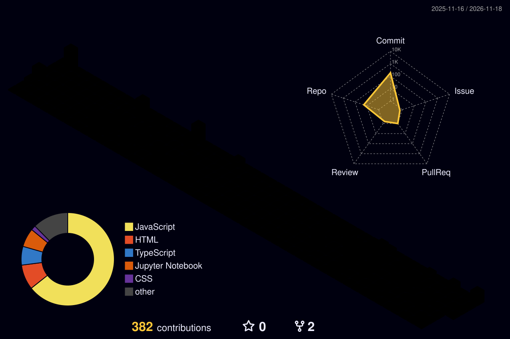
</picture>

 

<picture>
  <source media="(prefers-color-scheme: dark)" srcset="https://raw.githubusercontent.com/RithwikBandi/RithwikBandi/output/github-snake-dark.svg" />
  <source media="(prefers-color-scheme: light)" srcset="https://raw.githubusercontent.com/RithwikBandi/RithwikBandi/output/github-snake.svg" />
  
</picture>

 

<picture>
  <source media="(prefers-color-scheme: light)" srcset="https://streak-stats.demolab.com/?user=RithwikBandi&theme=default&hide_border=true" />
  
</picture>

 

<picture><source media="(prefers-color-scheme: light)" srcset="assets/light/h-connect.svg" /></picture>

If you have an idea, a project that needs a developer, or you just want to talk tech and startups, say hi.

<a href="https://rithwikbandi.tech"><picture><source media="(prefers-color-scheme: light)" srcset="assets/light/btn-portfolio.svg" /></picture></a>
<a href="https://www.linkedin.com/in/rithwik-bandi/"><picture><source media="(prefers-color-scheme: light)" srcset="assets/light/btn-linkedin.svg" /></picture></a>
<a href="https://www.burntstack.com"><picture><source media="(prefers-color-scheme: light)" srcset="assets/light/btn-burntstack.svg" /></picture></a>

 

<picture><source media="(prefers-color-scheme: light)" srcset="assets/light/footer.svg" /></picture>

