 

 

 

I'm a **Computer Science student at SR University (Warangal)** who builds real products instead of waiting for permission to. I design and ship full-stack web apps, train and explain machine-learning models, and run two ventures on the side: a custom web studio and a personal-branding agency. I document the whole journey in public, one short video at a time.

 

<table>
<tr>
<td></td>
<td></td>
<td></td>
</tr>
</table>

 

<table>
<tr>
<td></td>
<td></td>
<td></td>
</tr>
<tr>
<td></td>
<td></td>
<td></td>
</tr>
</table>

 

  

 

 

<picture>
  <source media="(prefers-color-scheme: dark)" srcset="https://raw.githubusercontent.com/RithwikBandi/RithwikBandi/output/github-snake-dark.svg" />
  <source media="(prefers-color-scheme: light)" srcset="https://raw.githubusercontent.com/RithwikBandi/RithwikBandi/output/github-snake.svg" />
  
</picture>

 

 

If you have an idea, a project that needs a developer, or you just want to talk tech and startups, say hi.

 

